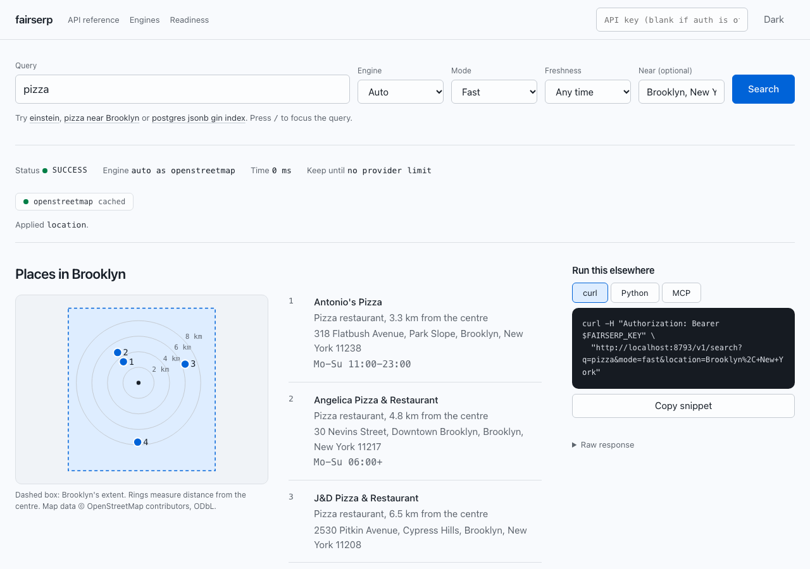

# fairserp

**Self-hosted search infrastructure for AI agents, with provenance on every result.**

fairserp sits between your agents and the search providers you are allowed to use. Every
result says which provider returned it, at what rank, under what provenance and terms, and how
long you may keep it. Every response says which params were applied and which were ignored,
and failures are reported as failures. A SerpApi-compatible endpoint lets existing code
migrate.

What it is not: a Google scraper or a source of Google rankings. fairserp ships no HTML
scrapers, no headless browser, no challenge solving and no proxy rotation. In 2026 the live
legal risk for SERP tools is DMCA § 1201 anti-circumvention, and it reaches tool authors and
API customers (`docs/RESEARCH.md`).

## Quickstart

```bash
# Local, no Docker, auth off because it only listens on 127.0.0.1:
FAIRSERP_OPT_IN=firecrawl uvx --from git+https://github.com/maximilliangrand/fairserp fairserp

# Docker: the app plus a cache Redis and a non-evicting state Redis
FAIRSERP_API_KEYS=my-secret FAIRSERP_OPT_IN=firecrawl docker compose up -d
# or a released image
docker run -p 127.0.0.1:8000:8000 -e FAIRSERP_API_KEYS=my-secret -e FAIRSERP_OPT_IN=firecrawl \
  ghcr.io/maximilliangrand/fairserp:0.2.0
curl -H "Authorization: Bearer my-secret" "http://localhost:8000/v1/search?q=rust+async+runtime"
```

Then open http://localhost:8000/ for the playground. `fairserp --port 9000` (or `--host`)
changes where it listens; it also reads `HOST` and `PORT`. Listening on anything other than
loopback requires `FAIRSERP_API_KEYS`, and the server says so at startup if it is missing.

With no keys and no opt-in, local search (`vertical=local&location=...`) and
`engine=wikipedia` still work; general web search needs a provider from the table below.

**Why `FAIRSERP_OPT_IN`:** the default `strict` profile only runs providers that disclose where
their results come from: their own index (Brave, Mojeek) or open data (Wikipedia, Wikidata,
OpenStreetMap). With no provider keys, nothing in that set returns general web results, so
fairserp refuses to guess and tells you how to proceed:

| You have | Set |
|---|---|
| A Brave or Mojeek key (paid, card required) | `FAIRSERP_BRAVE_API_KEY=...` or `FAIRSERP_MOJEEK_API_KEY=...` (strict, no opt-in) |
| No keys, and accept undisclosed provenance | `FAIRSERP_OPT_IN=firecrawl` (keyless, per-IP cap). Its results carry Google click parameters |
| A free Tavily key | `FAIRSERP_TAVILY_API_KEY=... FAIRSERP_OPT_IN=tavily` |
| Your own SearXNG | `FAIRSERP_SEARXNG_URL=... FAIRSERP_OPT_IN=searxng` (status follows its engines) |
| A noncommercial deployment | `FAIRSERP_NONCOMMERCIAL_DEPLOYMENT=true` enables Marginalia's free index (CC-BY-NC-SA) |

## Playground

`GET /` serves a playground: run a query, see each result's provider, rank and provenance,
the provider status strip, applied and ignored params, retention and attribution, and copy
the same search as curl, Python or an MCP config. Its scripts, styles and map are served by
fairserp itself under a hash-pinned Content-Security-Policy; the only third-party requests
are knowledge-graph images, loaded from the source that supplied them (usually Wikimedia).



## The native API

`GET /v1/search?q=...` or `POST /v1/search` with a JSON body. Params: `engine` (`auto` or a
name), `mode` (`fast`, `research`, `private`), `vertical` (`web`, `local`), `num`, `offset`,
`country`, `language`, `safe`, `freshness` (`h/d/w/m/y`), `location`, `strict_params`.
The OpenAPI document is at `/docs`.

```json
{
  "status": "partial",
  "resolved_engine": "auto",
  "params": {"applied": ["country"], "ignored": ["freshness"]},
  "providers": [
    {"engine": "brave", "role": "organic", "status": "ok", "latency_ms": 412, "results": 10},
    {"engine": "wikidata", "role": "enrichment", "status": "ok", "cached": true},
    {"engine": "duckduckgo_ia", "role": "enrichment", "status": "timeout",
     "error": "enrichment time budget exceeded"}
  ],
  "results": [{
    "rank": 1, "url": "https://tokio.rs/", "canonical_url": "https://tokio.rs",
    "title": "Tokio - An asynchronous Rust runtime", "snippet": "...",
    "published_at": null, "updated_at": null,
    "sources": [{"engine": "brave", "rank": 1, "provenance": "own-index"}]
  }],
  "entity": {"title": "Tokio", "wikidata_id": "Q...", "attributes": {}},
  "attribution": ["Search results from Brave Search", "Facts from Wikidata (CC0); ..."],
  "rights": {"brave": {"provenance": "own-index", "max_storage_seconds": 0, "...": "..."}},
  "retention": {"expires_at": "2026-10-23T10:00:00+00:00",
                "reason": "shortest storage limit among contributing providers"}
}
```

Outcome statuses: `success`, `partial` (results, but a provider failed or timed out),
`empty` (every provider answered, none had results), `rate_limited` (HTTP 429 with
`Retry-After`), `failed` (HTTP 502). An upstream failure is never reported as an empty
success.

Modes: `fast` (default) uses one organic provider and falls through on failure or emptiness
(reported). `private` sends the query to exactly one upstream and skips enrichment.
`research` is **experimental**: it queries up to `FAIRSERP_RESEARCH_FANOUT` permitted
providers concurrently and fuses them with Reciprocal Rank Fusion, keeping each provider's
own rank. In the [2026-10-23 benchmark](bench/README.md), fusing Firecrawl with Wikipedia
*lowered* MRR@10 from 0.971 to 0.784 on the queries both answered, so it is not the default.

## MCP server and fetch

```bash
claude mcp add fairserp -e FAIRSERP_OPT_IN=firecrawl \
  -- uvx --from git+https://github.com/maximilliangrand/fairserp fairserp mcp
```

The MCP server runs searches itself; it does not talk to a fairserp HTTP server, so it needs
its own provider settings in its environment (`-e` above, or an `env` block in a JSON MCP
config). Without one, `web_search` answers `refused` with a `fix` explaining what to set;
`local_search` and `fetch` work with no settings.

The tools are `web_search`, `local_search` and `fetch`. They return compact cited evidence:
numbered results with the provider, rank and provenance of each, degraded providers, ignored
params and attribution. The same policy, budgets and retention rules apply as on the HTTP API.

`fetch` (also `GET /v1/fetch?url=&question=`) reads one public page and returns the passages
most relevant to the question, plus title, published and updated dates, and the final URL.
It respects robots.txt per RFC 9309 (wildcards, longest match; an unreachable robots.txt
means do not fetch). It pins DNS to checked public addresses, rechecks every redirect hop
(at most three), refuses private, loopback, link-local and CGNAT ranges, and caps size, time
and content type.

## Providers, rights and policy

[docs/CAPABILITIES.md](docs/CAPABILITIES.md) is generated from adapter metadata. It covers
provenance, commercial use, storage limit, attribution, supported params, depth, and whether
parser fixtures were recorded from the real API. In summary:

| Engine | Provenance | Default profile | Notes |
|---|---|---|---|
| brave | own index | strict | Paid key. Terms allow no storage: never cached or archived |
| mojeek | own index | strict | Paid key. Storage capped at 1 hour |
| wikipedia, wikidata | open data | strict | Keyless. Wikidata gives the knowledge graph with fuzzy matching ("einstein" works) |
| duckduckgo_ia | aggregator | strict | Keyless instant answers; each abstract names its source |
| openstreetmap | open data | strict | Keyless local results via Nominatim: OSM categories, distance-sorted. Public instance 1 req/s |
| marginalia | own index | needs noncommercial declaration | Free keys are CC-BY-NC-SA. Without `FAIRSERP_MARGINALIA_API_KEY` it uses the shared `public` key, which is often exhausted |
| firecrawl | undisclosed | opt-in | Keyless tier. Results carry Google's `srsltid` |
| tavily | undisclosed | opt-in | Free key. Its answer is model-generated and labeled as such |
| exa, parallel, jina | undisclosed | opt-in | Keyed (`FAIRSERP_EXA_API_KEY` etc.) plus `FAIRSERP_OPT_IN=exa` |
| searxng | user-operated | opt-in | Rights follow your instance's engines |

`GET /v1/engines` shows the same data live, including why an engine is disabled.

## Guarantees and how they are enforced

- **Retention.** Each provider fragment carries an absolute deadline (`fetched_at + max_storage`).
  Fragments are cached independently, so Brave being uncacheable does not stop Wikidata
  from being cached. The archive keeps an outcome only until the earliest deadline among its
  contributors; past it, the archive answers 410 with the reason.
- **Quotas.** Per-key hourly and monthly limits are reserved atomically before a search and
  refunded to the same bucket if it fails or is fully cached. Accounting lives in a separate
  non-evicting store.
- **Upstream budgets.** `FAIRSERP_UPSTREAM_BUDGETS=firecrawl:900/month,firecrawl:100/day/key`
  caps calls to one provider server-wide and per key.
- **Deadlines and breakers.** One overall request deadline, a separate enrichment budget so a
  slow enricher never holds organic results, and per-engine circuit breakers that honor
  `Retry-After`. Nominatim spacing is coordinated across workers and gives up rather than
  queueing.
- **Params.** Each engine declares what it can honor. Ignored params are reported, or rejected
  with `strict_params`. `safe` is never relaxed: engines that cannot filter are skipped.
- **Egress.** Upstream redirects are not followed and `HTTP(S)_PROXY` env vars are ignored
  unless `FAIRSERP_HTTP_TRUST_ENV=true`. There is one optional proxy plus sticky per-engine
  overrides; there is no rotation.
- **Secrets.** Bearer auth is preferred. Keys are stored hashed, and query-string secrets
  (including encoded names like `api%5fkey`) are redacted from access and HTTP client logs.
  `zero_trace=true` also redacts the query and skips the archive.
- **Async.** `async=true` jobs run in-process with a lease. They are **not durable**: a job
  interrupted by a restart reads as failed.

## Clients

| | |
|---|---|
| Python | `from fairserp.client import Fairserp, AsyncFairserp` (explicit `base_url`, typed `SearchOutcome`; `api_key` is optional when the server has auth off) |
| TypeScript / Node | `clients/typescript` (`fairserp-client`, explicit `baseUrl`, typings included) |
| LangChain | `fairserp.integrations.langchain.FairserpSearchTool` or `FairserpAPIWrapper` (`pip install fairserp[langchain]`) |
| SerpApi clients | See [docs/MIGRATION.md](docs/MIGRATION.md). Do not patch LangChain's `SerpAPIWrapper`: its async path leaks your key and queries to serpapi.com |

CI's `client-truth` job records where each of these clients actually sends its requests.

## Running in production

- **Keys and auth.** Set `FAIRSERP_API_KEYS`. With auth off (`FAIRSERP_AUTH_DISABLED=true`,
  or the automatic loopback default), the server only answers requests addressed to
  `localhost`, `127.0.0.1`, `::1` or the host in `FAIRSERP_PUBLIC_URL`, which blocks DNS
  rebinding from a browser.
- **Public URL and proxies.** Set `FAIRSERP_PUBLIC_URL=https://search.example.com` so self
  links never come from a client's `Host` header. Behind a reverse proxy on another host,
  set uvicorn's `FORWARDED_ALLOW_IPS` to the proxy's address so `X-Forwarded-Proto` is
  trusted. Request bodies over 64 KB are refused with 413; set a similar limit on the proxy.
- **Redis.** Use two instances (`docker-compose.yml` does): an LRU one for
  `FAIRSERP_CACHE_BACKEND` and a `noeviction`, persisted one for `FAIRSERP_STATE_BACKEND`.
  Redis 6.2 or newer. If the cache is unreachable, searches carry on uncached (a warning is
  logged, and Redis is retried after a few seconds rather than on every call), but nothing
  is archived and `async=true` is refused with 503 rather than accepted and lost. If the
  state store is unreachable, requests get 503 `store_unavailable` rather than running
  without quota accounting.
- **Health.** `/healthz` is liveness (the process answers). `/readyz` is ready when the
  state store answers; it reports the cache too, without failing on it. The container
  healthcheck uses `/readyz`. Both skip the auth-off Host check, so probes can use any
  address.
- **Config errors stop startup.** Malformed `FAIRSERP_*` values fail at boot with the
  variable named, and misspelled engine names are logged at startup.
- **Logs.** Provider keys and client keys are redacted everywhere, including MCP stderr.
  `FAIRSERP_LOG_QUERIES=false` also keeps search text out of access logs.
- **`/docs`** loads Swagger UI from jsDelivr, pinned to one release with Subresource
  Integrity. Everything else is served by fairserp itself.

## Configuration

All settings are `FAIRSERP_*` environment variables; `.env.example` lists them with comments.
The most important:

| Variable | Default | Purpose |
|---|---|---|
| `FAIRSERP_API_KEYS` | (empty: reject all) | `key`, `key:hourly` or `key:hourly:monthly` |
| `FAIRSERP_PROFILE` / `FAIRSERP_OPT_IN` | `strict` / empty | Provider policy |
| `FAIRSERP_SERPAPI_ENGINES` | empty | SerpApi migration mapping, e.g. `google:auto` |
| `FAIRSERP_ORGANIC_PRIORITY` | brave, mojeek, marginalia, tavily, exa, parallel, jina, firecrawl, searxng | Order for `auto` |
| `FAIRSERP_CACHE_BACKEND` / `FAIRSERP_STATE_BACKEND` | `memory` | `redis://...`; use an LRU instance for cache and a `noeviction` one for state |
| `FAIRSERP_PUBLIC_URL` | request host | Base for self links |
| `FAIRSERP_UPSTREAM_BUDGETS` | firecrawl caps | Per-provider call budgets |
| `FAIRSERP_REQUEST_DEADLINE_SECONDS` / `..._ENRICHMENT_BUDGET_SECONDS` | 15 / 2.5 | Time budgets |
| `FAIRSERP_USER_AGENT` | fairserp/0.2 | Put a contact address here (Wikimedia and OSM policy) |

## Adding an engine

Subclass `fairserp.engines.base.Engine` and declare `rights`, `supports`, `max_depth` and
`required_settings`. Implement `fetch()` (raw upstream payload) and a pure `parse()` that
returns an `EngineOutput` and raises `PayloadError` on malformed input. Then record a fixture
with `scripts/record_fixtures.py`, add contract and parser tests, and regenerate the matrix
with `scripts/capabilities.py`. External packages can register engines through the
`fairserp.engines` entry-point group.

## Benchmark

`bench/` holds a stratified 50-query benchmark: technical, navigational, entity, news,
multilingual and local. The first run (keyless providers only) found:
- Wikidata entity resolution 7/7 correct;
- OpenStreetMap local results 6/6;
- Firecrawl hit@3 1.0 on technical queries;
- fusing Firecrawl with Wikipedia *hurt* ranking, which is why `fast` is the default.

Method, caveats and numbers: [bench/README.md](bench/README.md).

## Development

```bash
uv sync
uv run pytest       # parsers, contracts, core policy, limits (memory and Redis), API, clients
uv run ruff check .
```

Required CI runs those tests, the client-truth tests and a Docker Compose stack against a
mock upstream. `canary.yml` runs live provider queries and is informational only.

Contributions: read [CONTRIBUTING.md](CONTRIBUTING.md) first; it states the sourcing line
PRs must respect. Security reports: [SECURITY.md](SECURITY.md). Releases and deprecation:
[RELEASING.md](RELEASING.md). Plans: [ROADMAP.md](ROADMAP.md).

## License

Apache-2.0 for the code. Data stays under each provider's
terms: OpenStreetMap is ODbL, Wikipedia text is CC BY-SA, Wikidata is CC0, Marginalia's free
tier is CC-BY-NC-SA, and commercial APIs follow your agreement with each provider.
